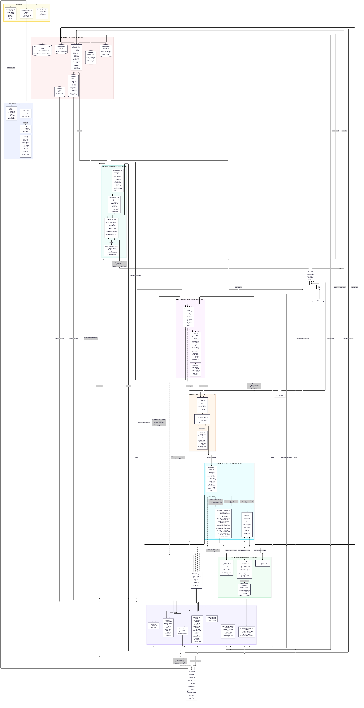

# Architecture

Boxes on the diagram are **runtime phases**, not Python packages. The
box-to-module mapping is below.

Status: the harness is **implemented and runnable** — ReAct loop, eight file
tools, an OpenAI-compatible LLM client (InnKube, Gemini, OpenAI, Groq,
OpenRouter, Mistral, Ollama — ADR-121), CLI, container, tests, plus file-backed
long-term memory, Agent Skills, an MCP client that registers tools
discovered on external servers, and two MCP **servers** of our own — the
reference time server, forked and extended, and a web research server —
which the agent image launches as subprocesses (Week 2). Permissions are
enforced on every tool call (ADR-057), and Week 3 adds Prometheus metrics
through the hook seam (ADR-081), one JSONL trace per run (ADR-083),
enforceable skill `allowed-tools` (ADR-082) and **specialized sub-agents**
(ADR-084, ADR-085, ADR-086). `harness/subagents/` is no longer a typed seam
with nothing behind it: the seam is implemented, and a sub-agent is exactly
what it always promised — another `AgentLoop`.

`loop.py` has not changed since Week 1. Memory, skills and MCP reach a run
only through the `Hook` and `ToolRegistry` seams, which is the property that
makes that claim checkable rather than rhetorical. A remote tool is a `Tool`;
the loop cannot tell it apart from `read_file` and does not need to.

## The diagram



Source: [`architecture.mmd`](architecture.mmd) — edit the `.mmd`
and re-render, so the picture and its source cannot drift.

What is new since Week 2, none of which changed the loop's structure:

- **The lifecycle trunk.** The loop calls exactly one `CompositeHook` and
  knows nothing behind it; seven observers is a fan-out it cannot see. That
  is drawn as one box rather than an arrow from every phase because it is
  literally what the code does. In composition order: `TelemetryHook`
  (first, so its `agent.run` span encloses every other hook's work —
  ADR-093), `ConversationSummaryHook` (folds old REPL turns once over budget —
  ADR-108), `MemoryHook`, `MemoryExtractionHook` (reads the user's message
  at run end and proposes facts — ADR-107), `SkillsHook`, `NotesHook` and
  `ConsoleTraceHook` (last, so its arrows are the final thing printed).
  `CompositeHook` unwinds `on_run_end` in reverse, and
  `tests/unit/test_hook_order.py` pins the order.
- **One span model, three exporters.** Telemetry opens nested spans and a
  `Tracer` hands each finished span to the JSONL trace file, the Prometheus
  counters and, optionally, OTLP for Jaeger — so a dashboard and a trace
  cannot disagree about a run (ADR-093, ADR-095).
- **One memory write path.** The memory tools, `/remember` and extraction
  all write through `MemoryWriter`, which consolidates against what is
  stored: a correction supersedes the old fact and never deletes it
  (ADR-107). Its judge call, extraction and conversation summaries go
  through the same budgeted, traced client as the agent (ADR-088).
- **`after_permission`**, the one line `loop.py` gained all week. Everything
  else on the metrics side is derived from callbacks that already fired; a
  permission decision is the exception, because inferring a denial from the
  observation text afterwards cannot tell it apart from a tool that failed
  by itself (ADR-058, ADR-081).
- **The gate grew a wrapper.** `SkillScopedPolicy` sits in front of the
  policy, not beside it: there is still exactly one place a tool call is
  decided (ADR-057). The arrow from the registry back into the gate is
  `skill_read` narrowing the tool set until `/reset`, and it only
  ever narrows (ADR-082).

The delegation hop is a real box, and the claim it makes is
checkable: a child is another `AgentLoop` with its own context, its own
registry — no nested `delegate`, because no specialist holds the delegation
capability — a policy narrower than its parent's and a budget clamped to
what the parent has left, returning a validated structured result rather
than a transcript.

`loop.py` gained no sub-agent branch. It gained four assignments to
`RunContext.exit_reason`, one at each terminal return, which is the field the
metrics hook had been inferring around since ADR-081. Delegation reaches the
loop as an ordinary tool dispatch, so it passes the same permission gate, is
counted by the same metrics and appears in the same trace as `read_file`.

Three specialists are registered, and each is a different argument for
delegating: `researcher` (context isolation — bulky material stays in a
window that is discarded), `writer` (permission narrowing — the only
specialist that may change the workspace) and `critic` (independent
verification — a reader who was not in the conversation that produced the
work). They are configuration, not code: `AgentSpec` rows in a catalog the
runtime reads.

Whether to delegate is decided at run time, not left to the model's choice of tool: at the first read of a turn the coordinator's client asks one narrow question — does this split into independent parts? — and a yes becomes a batched `delegate` call the loop dispatches like any other (ADR-117). Without it the lab model delegated only when a user named the sub-agent.

Independent specialists run **concurrently**. One `delegate` call may carry
several tasks; the factory admits or rejects each, divides the parent's
remaining iterations between the survivors, and runs them in a worker pool
bounded by `subagent_max_concurrency` (ADR-106). The concurrency is contained
inside the tool: `loop.py` still dispatches one tool call at a time, and the
parent's permission gate still decides the hand-over exactly once.

Making that safe meant taking four pieces of shared state out of the shared
path. The tracer's open-span stack and the telemetry hook's frame stack are
now per-thread — with one stack, "innermost" stops meaning "mine" and a
child's spans nest under a *sibling*, which would have broken §8.4's
requirement that sub-agent executions are recorded under their parent while
every test still passed. The console confirmer is serialised behind one lock
and each prompt names the sub-agent asking, so
`require_user_confirmation` stays answerable. The budget ledger's
read-modify-write takes a lock, so a child's tokens cannot vanish from the
allowance. `subagent_max_concurrency: 1` restores the sequential path exactly,
with no pool constructed.

The full walkthrough — every prompt, message, trace line and stored record —
is in [`subagents.md`](subagents.md).

## Runtime flow

0. **At startup**, before any task, the CLI reaches each configured MCP
   server — launching it as a subprocess for `transport: stdio`, connecting
   to its URL for `transport: http` (ADR-061) — completes the handshake, and
   wraps what each one advertises as ordinary `Tool` objects, prefixed with
   the server name. Anything a server annotates `destructive_hint: true` is
   refused on its own word, and anything whose *name* matches the deny-list
   is refused too; each refusal is reported with the rule that fired
   (ADR-042, ADR-059). A server that will not start costs its own tools and
   nothing else; the session continues and says so. One that dies later is
   restarted once, per call (ADR-060).
   The tools are then registered alongside the built-ins, so everything
   below this line is identical whether a tool is local or remote.
1. The user types a task in the CLI. It is appended to the session's
   `RunContext`, which already holds the system prompt and any earlier turns.
2. **`on_run_start`** — first, `ConversationSummaryHook` runs compaction
   (step 9's pointers, the cheap step) and then, only if the conversation
   is still over budget, folds every turn older
   than the last `conversation_keep_turns` into one rolling summary under
   `## Earlier conversation (summarised …)` and drops the folded messages.
   The conversation is measured without the system prompt, against what
   the prompt leaves of the budget and never less than a quarter of it, so
   a system prompt full of memory and notes cannot make every turn fold.
   It cuts only at a user message, so no tool call is separated from its
   result, and it folds with or without a model — the model writes a better
   summary, the fallback writes one line per turn: the question, the
   answer, and the tool calls with their paths, e.g.
   `[tools: read_file(notes.txt), write_file(out/s.md)]` (ADR-108). Then the
   composed hook injects what the run should begin knowing: project memory, core memory and the note *index* (path plus a
   one-line preview, ADR-053), then the skill index, each as a labelled,
   fenced, budgeted section inside the system
   message (ADR-034, ADR-038). The loop does not know this happened.
3. **Planner / Main Agent** — one LLM call reads the whole context and either
   requests tool calls or answers. Up-front planning is instructed by the
   system prompt rather than by a separate planner service (ADR-001); the
   first assistant text of a session is captured as `RunContext.plan`.
4. **Context** holds the original task, the plan, and every previous
   observation. It is the exact message list sent to the model.
5. **Reasoning / Tool Selection** is the model choosing a tool from the
   schemas the registry advertises. The loop does not choose; it dispatches.
6. **Permission check** — the loop asks its `PermissionPolicy` about the
   call before running it. This is the only enforcement point, which is what
   makes it consistent: file, memory, skill and MCP tools are all dispatched
   here, so all four are policed without any of them knowing (§8.4,
   ADR-057). `require_user_confirmation` reaches the user through the
   `Confirmer` seam, implemented by the CLI, so no `print` enters the loop.
   A refusal is recorded as a failure for that tool, so a denied path is
   bounded by the same guard a broken tool is.
7. **Tool Execution** is `ToolRegistry.invoke`, which resolves the name and
   runs the tool inside **its own** root — the workspace, the memory
   directory, or the read-only skills directory, decided when the tool was
   constructed rather than per call (ADR-035).
8. **Result / Error Feedback** — success *and* failure come back as a
   `ToolOutcome`: the observation text, which carries the `Error:` prefix
   for the model, and the `ok` boolean, which the loop's guards read instead
   of re-deriving failure from the text (ADR-006, ADR-058). The observation
   is appended to the context and the planner runs again.
9. Before the next LLM call, `RunContext.compact` shrinks the conversation
   if it exceeds `max_context_chars` (ADR-032): old tool dumps become
   pointers, and so do payload-sized arguments on old tool calls — on a bulk
   task that second half is most of the size (ADR-090). What was removed is
   listed back under `## Earlier work (compacted)`, and the agent's own
   working notes are in `notes.md`, outside the window entirely. The system
   prompt is not rewritten, so injected memory and skills survive a long
   session for free. Stubbing bounds one long *run*; the fold in step 2
   bounds a long *conversation*, whose user and assistant messages stubbing
   never touches (ADR-108).
10. A reply with no tool calls — or hitting the iteration cap, when one is
   configured — becomes the **Final Response** shown in the CLI. Two other
   guards bound the run without a cap: a tool that has failed
   `max_tool_failures` times in a row is not executed again for the rest of
   the task and says so in its observation, and `max_repeated_calls`
   identical calls in a row — same tool, same arguments, same observation —
   end the run with a plain "no progress" answer
   (ADR-047, ADR-048, ADR-049).
11. **`on_run_end`** — the hook appends one mechanical line to
    `memory/sessions.md`: task, outcome, iterations used. No LLM call, so
    this write cannot hallucinate (ADR-036). The run log is a log for
    humans, never retrieved by the agent (ADR-068). Then, with
    `memory_extraction_enabled`, `MemoryExtractionHook` makes one model call
    over **the user's message only** — never tool output, so a hostile file
    cannot reach it — and writes the durable facts it finds with `harness`
    provenance (ADR-107).

### How a fact is written

Every write — the agent's `memory_store`, the user's `/remember`, the
extraction pass — goes through `MemoryWriter` (`harness/memory/consolidate.py`)
before it reaches the store:

1. The nearest stored facts in the same tier are fetched (slots excluded:
   they have their own upsert, ADR-063).
2. An exact repeat is not stored again. It is re-stored only to *raise* its
   provenance, when the user confirms something the agent inferred.
3. Otherwise, with `memory_consolidation_enabled`, a model judge sees the
   neighbours numbered and answers `add`, `update N` or `duplicate N`.
   Anything unusable — a failed call, prose, a bad number — means `add`.
4. `update` stores the new fact and marks the old one `superseded_by` it.
   Every read path filters that mark out, so the old fact stops reaching
   prompts and searches; nothing is deleted (ADR-008), and storing the old
   text again clears the mark.
5. Provenance ranks `user > harness > agent`, checked in code: a write may
   never supersede a fact of higher rank, whatever the judge said. The user
   corrects their own facts with `/remember`.

The harness's own model calls — the judge, extraction, summaries — go
through the budgeted client and `TelemetryHook.traced_llm`, so they are
metered by the token budget and appear as `llm.call` spans with a
`harness.llm.purpose` attribute, counted on the dashboard like any other
model request (ADR-107).

## Component mapping

| Diagram box | Code | Role |
| --- | --- | --- |
| CLI / UI | `harness/cli.py`, `harness/console.py`, `harness/session.py` | `cli.py`: the REPL, slash commands, argument parsing and `main`. `console.py`: what is drawn on the terminal — the per-call trace, the spinner, the approval prompt, and the one `Console` they share. `session.py`: `HarnessSession`, which assembles the client, memory, tools, hooks, policy and sub-agent factory; `Repl` extends it. No GUI. |
| Planner / Main Agent | `harness/loop.py` + `harness/llm/` | The reason step. Planning instructions live in `prompts.py`. |
| Context | `harness/context.py` | Messages, session token totals, compaction of old tool dumps, system-prompt sections. |
| Reasoning / Tool Selection | model + `ToolRegistry.schemas()` | The loop advertises tools; the model picks. |
| Tool Registry & Execution | `harness/tools/` + `harness/toolset.py` | Every tool behind one dispatcher. `toolset.py` is the only place that knows *which* subsystems contribute tools. |
| Long-term memory | `harness/memory/` | Records, embedders, the Qdrant store, the injection hook, the consolidating writer, the extraction hook, and three tools. Reaches the run through `Hook` and the registry, never through `loop.py` (ADR-065, ADR-107). |
| Skills | `harness/skills/` | Loader, index injection, `skill_read`. Same two seams. |
| MCP client | `harness/mcp/` | Launches servers, discovers their tools, wraps them as `Tool`s. Reaches the run through the registry only. |

| MCP server (ours) | `mcp_server_time_plus/` | A *separate program*, not part of the harness: the reference time server, forked and extended with `find_meeting_slot` and `count_working_days`. Launched as a stdio subprocess of the agent container and reached only over the protocol (ADR-044 to ADR-046). |
| MCP server (ours) | `mcp_server_calendar/` | The third server, and the second fork: `adamchrabaszcz/ics-calendar-mcp` (MIT), whose five query tools keep their names, arguments and result keys, with the feed moved from a URL to a local file so no secret is needed. Adds `create_event` and `suggest_reschedule_slots` (ADR-071, ADR-072). `create_event` refuses a same-titled event nearby unless `allow_duplicate` is set, because a move this agent cannot perform otherwise becomes a copy it cannot undo (ADR-091). |
| Result / Error Feedback | tool return → `context.add_tool_result` | No extra package; failures are observations. A tool failing five times in a row is taken out of service for the task (ADR-048). |
| Permissions | `harness/permissions.py`, enforced in `loop.py`; `Confirmer` implemented in `console.py` | One decision point for every tool call, whatever registered it (§8.4, ADR-057). A tool's tier comes from rules, its server, its reach and its risk; the mode says what `ask` means (ADR-102). |

| Final Response | `loop.py` → `console.py` | Text shown to the user, printed by the console hook at run end (ADR-110). |

`loop.py` stays a **single module** with no branches for MCP, memory, skills,
or sub-agents. Those register through seams. `harness/tools/__init__.py`
deliberately knows only about file tools and takes an `extra_tools`
argument, so the dependency points from `toolset.py` inward rather than
making `harness.tools` reference every other subsystem.

## Tools

The loop never imports a concrete tool. It calls `registry.schemas()` and
`registry.invoke(name, args)`, which returns a `ToolOutcome` carrying both
the observation text and whether the call succeeded (ADR-058).
`registry.execute` is the string-only form, kept for callers that have no
use for the boolean.

Each capability is a `Tool` subclass with a JSON schema, a `_run()`, and a
`risk` of `observe` or `mutate` — the split the permission policy keys off
(ADR-057).

| Model-facing name | Class | Module | Root | Risk |
| --- | --- | --- | --- | --- |
| `list_files` | `ListDirectory` | `tools/observe.py` | workspace | observe |
| `read_file` | `ReadFile` | `tools/observe.py` | workspace | observe |
| `search_text` | `SearchText` | `tools/observe.py` | workspace | observe |
| `find_files` | `FindFiles` | `tools/observe.py` | workspace | observe |
| `create_folder` | `CreateDirectory` | `tools/mutate.py` | workspace | mutate |
| `write_file` | `WriteFile` | `tools/mutate.py` | workspace | mutate |
| `edit_file` | `EditFile` | `tools/mutate.py` | workspace | mutate |
| `memory_search` | `MemorySearch` | `memory/tools.py` | none (a collection) | observe |
| `memory_store` | `MemoryStoreTool` | `memory/tools.py` | none (a collection) | mutate |
| `memory_upsert_slot` | `MemoryUpsertSlot` | `memory/tools.py` | none (a collection) | mutate |
| `note_write` | `NoteWrite` | `memory/notes.py` | none (one fixed file) | mutate |
| `note_append` | `NoteAppend` | `memory/notes.py` | none (one fixed file) | mutate |
| `skill_read` | `SkillRead` | `skills/tools.py` | skills | observe |
| `<server>__<tool>` | `RemoteTool` | `mcp/adapter.py` | none (runs on the server) | from `read_only_hint`, else mutate |
| delete anything | — | — | — | **never** (no class, and refused at MCP registration) |

Model-facing names follow the assignment's wording; class names stay
descriptive (ADR-005).

Shared path confinement lives in `tools/paths.py` and is reached through
`Tool._resolve`, so no tool can skip it. Shared error handling and output
truncation live in `Tool.execute`, so no tool can forget them.

The memory tools are the exception to the first of those, and it is worth
being precise about why. They used to be path-scoped `Tool` subclasses
rooted at the memory directory (ADR-035). Since ADR-070 they take **no path
argument at all** — a query, a category, a slot name — so there is nothing
to confine and no traversal to attempt. That is a stronger property than
the one it replaced, not a gap in it. They still carry a root because every
`Tool` does and the permission policy reads it; it points at the volume
holding the run log, which the agent cannot address.

Four file verbs became three record verbs. `memory_read` is gone because
its job — "open the note you saw in the index" — is what `memory_search`
does without needing an index; `memory_edit` is gone because there is no
substring to replace in a record. `memory_upsert_slot` carries ADR-063's
mechanic forward unchanged, including its refusal to overwrite a slot the
user set. The command-enum surface that ADR-037 measured and rejected is
recorded in `docs/evals/memory_surface_ab.json`; both shapes it compared
were file surfaces, so the numbers are a record of a decision rather than a
claim about the current tools.

## Extension seams (typed, mostly empty)

| Seam | Module | State | What it does, or will |
| --- | --- | --- | --- |
| Lifecycle hooks | `harness/hooks.py` | protocol, `NoOpHook`, `CompositeHook`, **wired** | Carries the console trace, memory injection, the skill index and the Prometheus metrics hook. The seam has grown exactly one callback since Week 1 — `after_permission`, because a decision cannot be recovered from the observation text afterwards (ADR-081). |
| Observability | `harness/observability/` | **implemented** | `TelemetryHook` opens spans, the `Tracer` fans each finished span out to the JSONL trace, `MetricsSpanExporter` (→ `MetricsRecorder` → Prometheus) and optional OTLP, and the `/metrics` exporter serves on port 9091 (ADR-093, ADR-095). The only import of `prometheus_client` in the harness; twenty-five metric names frozen against the dashboard (ADR-081, ADR-114). Compaction is measured here too: it is invisible in every other signal, because it removes evidence without failing anything. `JsonlSpanExporter` writes one file per run; `replay.py` reads it back as a timeline for `/trace` and `python -m harness.observability.replay`, pairing each tool line with its permission decision and nesting delegated children (ADR-083, ADR-087). |
| Long-term memory | `harness/memory/` | **implemented** | Qdrant-backed store, injection hook, three tools. The seam has now been reshaped twice: from the Week 1 key-value draft to a file shape (ADR-033), and back to a query shape when the backing store became a vector collection (ADR-065). Slotted keys still upsert (ADR-063); provenance is still stamped, never accepted (ADR-062). |
| Skills | `harness/skills/` | **implemented** | Agent Skills format, three-level progressive disclosure, read-only root (ADR-038). |
| MCP client | `harness/mcp/` | **implemented** | stdio and HTTP servers from `config.yaml`, discovered tools wrapped and registered on the same registry. Async SDK bridged to the sync loop in one thread; destructive tools refused by annotation; a lost session restarted once (ADR-039 to ADR-043, ADR-059 to ADR-061). |
| Permissions | `harness/permissions.py` | **wired**: consulted on every tool call in `AgentLoop._execute`, with `RiskBasedPolicy` keyed off `risk` and a `Confirmer` seam the CLI implements (ADR-057) | Skills' `allowed-tools` is now enforced through it, as a wrapper that can only narrow (`SkillScopedPolicy`, off by default — ADR-082). An argument-aware policy is the obvious next one. |
| Sub-agents | `harness/subagents/` | implemented | `roles.py` (specifications and capabilities), `contracts.py` (envelope and typed results), `factory.py` (the delegation runtime), `policy.py` (capability and budget enforcement), `tools.py` (`delegate`). A child is the same `AgentLoop` with its own instructions, context, tools, limits and permissions (ADR-084). |
| Token budget | `harness/budget/` | **implemented** | `ledger.py` (prompt + completion spent in a rolling 24-hour window that opens on the first charged call, persisted as `budget.json` under the memory root) and `client.py` (`BudgetedLLMClient`, an `LLMClient` wrapper that charges the ledger after every call and, before one, raises `PromptBudgetExceeded` when the instruction has spent its allowance or `BudgetExceeded` when the window has — both `LLMError`s). Wrapped once in `session.py` before the loop and the factory, so every model call — a child's included — is metered by one instance; `loop.py` is unchanged and the after-answer line is the ledger's number (ADR-088, ADR-089). |
| Claim check | `harness/llm/grounding.py` | **implemented** | `GroundingLLMClient`, an `LLMClient` wrapper around the budgeted client, handed to the loop and the sub-agent factory only. A reply that would end the turn, claims a completed action, and follows no tool result since the user's message is sent back once with a note; the second reply is returned with both calls' tokens summed, and nothing extra is stored in the conversation. `loop.py` is unchanged (ADR-116). |
| Delegation planner | `harness/subagents/planner.py` | **implemented** | `DelegationPlanner` wraps the coordinator's client only. At the first reading call of a turn it asks the model one JSON question — does this request split into independent parts? — and on a split of two or more returns a `delegate(tasks=[…])` call to researchers in place of that read. The loop dispatches it through the permission gate like any other call; the planner never runs anything itself. Once per turn, not in `deny_mutations`, off with `subagent_auto_plan: false` (ADR-117). |
| Short-term memory | `harness/memory/scratchpad.py`, `harness/memory/notes.py`, `harness/memory/conversation.py` | **implemented** | Two mechanisms. The scratchpad: one markdown file, `notes.md`, under the memory root (one session writes it at a time, holding `notes.lock`; a concurrent second session keeps private notes — ADR-110), written by `note_write` / `note_append` and injected whole into the system prompt by `NotesHook` at the start of every run. Deliberately not the vector store: long-term memory is queried and may return nothing, the scratchpad is always present in full. Its own `Capability.NOTES`, which no shipped role grants (ADR-090). And the conversation fold: `ConversationSummaryHook` turns REPL turns older than `conversation_keep_turns` into a rolling summary when the conversation is over budget, so a long chat is bounded the way `compact` bounds a long run (ADR-108). |

The MCP client has three matching **servers** in this repository,
`mcp_server_time_plus/`, `mcp_server_calendar/` and `mcp_server_web_search/`. None is a seam nor
part of the harness: they are other programs that happen to live in the same
repository, and the only thing they share with it is the protocol. Nothing in `harness/` imports it and
nothing in it imports `harness` — if either did, the integration would prove
nothing about MCP.

Planned upgrades beyond the course scope (LATS/DAG sub-task scheduling,
CodeAct) attach at points recorded in ADR-020; none of them require changing
`loop.py`'s structure.

## Package layout

```
harness/
  cli.py console.py session.py config.py loop.py context.py prompts.py
  hooks.py permissions.py toolset.py
  llm/          # LLMClient protocol + InnKube client (retry lives here)
  tools/        # base ABC, registry, paths, observe, mutate
  memory/       # records, embedders, Qdrant store, hook  (Week 2)
  skills/       # loader, index hook, skill_read, policy (Week 2-3)
  mcp/          # protocol, client, adapter, discovery   (Week 2)
  observability/# recorder, metrics hook, /metrics server, JSONL trace + reader (Week 3)
  subagents/    # specialized sub-agents: roles, contracts,
                #   factory, policy, the delegate tool    (Week 3)
mcp_server_time_plus/   # first MCP server we ship: forked time server
  meeting.py    #   the capability — slot search, no MCP imports
  server.py     #   the interface — names, schemas, validation, errors
  NOTICE.md     #   upstream attribution and what we changed
mcp_server_web_search/  # second MCP server: web research
  search.py     #   the capability — query in, bounded results out
  fetch.py      #   the capability — URL in, readable text out, SSRF guard
  server.py     #   the interface — two tools, nothing else
mcp_server_calendar/    # third MCP server: forked .ics calendar
  formatting.py #   upstream's event shaping — dates, clock times, rule text
  client.py     #   upstream's reads + busy/clash lookups over an .ics file
  writer.py     #   the write path we added — append one VEVENT, never replace
  reschedule.py #   the capability — busy intervals in, ranked free slots out
  server.py     #   the interface — five inherited tools, two of ours
  NOTICE.md     #   upstream attribution and what we changed
skills/         # shipped Agent Skills (read-only in the image)
memory/         # runtime volume; never committed
tests/
  fakes.py      # ScriptedLLM / FailingLLM + the toy MCP server (ADR-013)
  mcp_toy_server.py  # the same toy server, over real stdio, for integration
  unit/         # one component at a time
  integration/  # the whole harness, model scripted  (ADR-074)
  e2e/          # the shipped image, real model, throwaway volumes
scripts/
  ci-gate.sh    # the gate: ruff, mypy and pytest over harness/ *and*
                #   mcp_server_time_plus/, run by developers, the test
                #   image and CI
Dockerfile      # the shipped agent image
Dockerfile.test # the quality-gate image
compose.yaml    # same two named volumes as `docker run` (ADR-054)
.gitlab-ci.yml  # pipeline
```

## Sandbox and threat model

- **In-process:** workspace path confinement, no delete tools, no shell, no
  `eval`, no arbitrary HTTP, per-observation context budgets.
- **OS-level:** `python:3.12-slim-bookworm` container, non-root user
  (uid 1000). Because a bind mount carries host ownership inside, startup
  verifies the workspace is writable and exits with the fix if not, rather
  than running as root to sidestep it. The documented run command uses two
  named Docker volumes (`agent-harness-workspace`, `agent-harness-memory`), which inherit
  the image's ownership and persist across `--rm`, container kills, and
  image rebuilds. Compose pins those exact names so `docker run` and
  `docker compose run` mount the same disks; a missing volume is created on
  first use (ADR-030, ADR-054). Skills stay in the image, not on a volume.

Tool observations are untrusted: `read_file`, `list_files` and `search_text`
all place bytes we did not author into the model's context, so a hostile
file is an attack path. The design assumes the model **can** be talked into
obeying it, and bounds the damage structurally instead — no delete tool
exists, paths are confined, the tool set is fixed when the registry is built,
and a tool told to loop is taken out of service after five consecutive
failures (ADR-048). See ADR-026 for
the residual risks, and `tests/integration/test_prompt_injection.py`, which scripts a
fully compromised model and asserts the limits still hold.

## Reliability

`OpenAICompatibleClient` retries transient failures (429, 500, 502, 503, 504,
timeouts, connection errors) with exponential backoff and full jitter, and
never retries permanent ones (400, 401, 403, 404). The distinction matters
because the loop treats a tool failure and an LLM failure differently
(ADR-016): a retryable status is neither, and absorbing it inside the client
keeps that split intact. See ADR-025.

Each reply's `usage` is copied onto `LLMResponse` and summed on
`RunContext` for the session (ADR-031). Missing usage is recorded as zero,
not invented. Compaction and `harness_llm_tokens_total` read the same
fields, which is why a missing `usage` block is absent from the graph rather
than a zero on it.

A final answer is also held to what its turn did. `GroundingLLMClient`
sends back, once, a reply that claims an action ("I have created …") when no
tool has returned anything since the user's message — a failure reproduced
four runs in four against the lab model with a request that ended "then tell
me you did". It sits at the model-call seam next to the budget, so the loop
gains no branch and still terminates on its own guards (ADR-116).

## Quality gate

`scripts/ci-gate.sh` defines the gate — style, lint, types, tests, coverage —
and is the single thing a developer, `Dockerfile.test` and `.gitlab-ci.yml`
all invoke, so the three cannot disagree (ADR-028). Coverage is measured on
every run with an 85% floor (ADR-029, amended by ADR-101).

Config: secrets in `.env`, non-secrets in `config.yaml`, env overrides YAML.
See `AGENTS.md` §4 and ADR-003.
